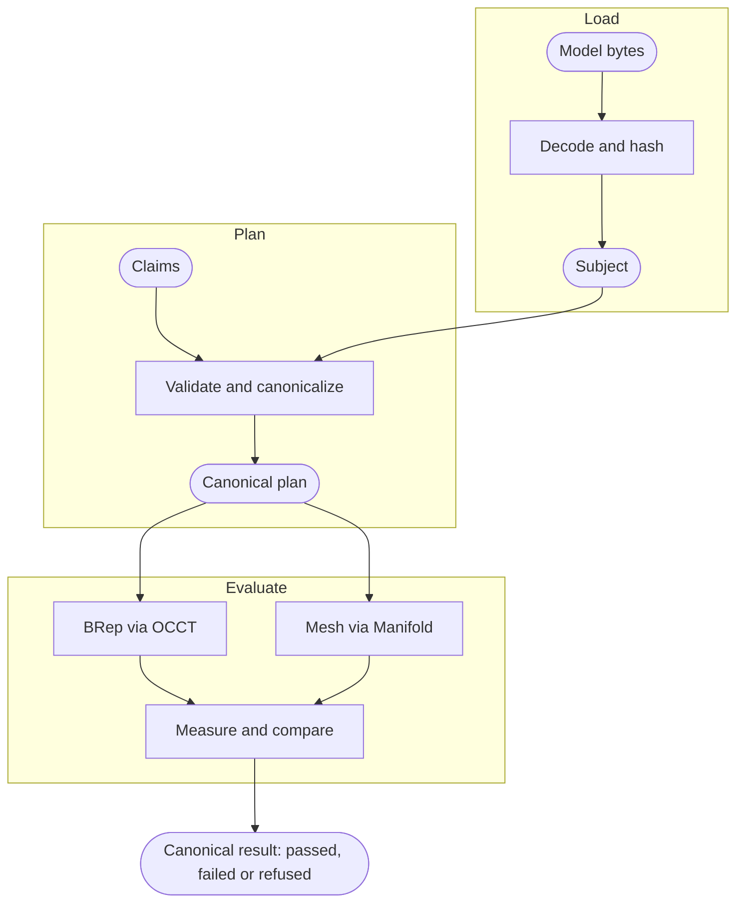

GeoSpec is a Rust engine behind two thin surfaces: the `geospec` npm package, which runs it as a native addon or as WASM in Node and in browsers, and the `geospec` Python package, which runs it as a CPython extension. Everything that decides a verdict happens in the engine, and the three builds return the same bytes for the same model and claims.

## Pipeline

A verdict moves through four stages. Loading can fail as a whole; after that each claim answers on its own, with a status and diagnostics.

**Load** reads a model's bytes once, decodes them and hashes them. The hash names the bytes; it does not establish that the geometry is right. Bytes the format cannot decode fail the load before any claim runs: `loadModel` throws `GeoSpecModelLoadError` and `load_model` raises.

**Plan** writes each claim as canonical JSON: the subject, the matcher, the expectation with its defaults filled in (a tolerance of 0.02 mm, whether it is negated, the work budget) and the claim's automatic id, with ordered keys and nothing else. The plan is what gets evaluated, so two calls with the same canonical plan ask the same question.

**Evaluate** measures each claim against the evidence its subject carries. A STEP solid is measured as BRep through OCCT; a mesh, from GLB or glTF, through the Manifold backend. A claim whose evidence the subject lacks is refused with `GEOSPEC_EVIDENCE_UNSUPPORTED`; one the backend cannot carry out on that evidence with `GEOSPEC_UNSUPPORTED_EVIDENCE`, a second code; one that spends its work budget with `MATCHER_TIMEOUT`; one over an analysis or admission limit with `GEOSPEC_ANALYSIS_LIMIT` or `GEOSPEC_RESOURCE_LIMIT`; a backend that cannot complete with `GEOSPEC_BACKEND_FAILED` or `GEOSPEC_INVALID_EVIDENCE`.

**Report** writes one result per claim as the same canonical JSON. `report.canonicalResult` (Python `canonical_result_bytes`) is the engine's response, untouched, and `report.result` is this claim's entry in it, parsed.

## Subjects and evidence

A subject is one model `loadModel` has loaded, in one frame: z-up, measured in millimetres.

- **STEP** (`format: 'step'`) is read in its own unit. A STEP solid carries BRep evidence: faces with their surfaces, edges and the topology between them.
- **GLB and glTF** (`format: 'glb'` or `'gltf'`) carry triangles only. The load declares their unit, `sourceUnit: 'mm'` for a millimetre export and metres by default (Python `source_unit`), and names any external buffers as `resources`. Separate meshes and instancing nodes stay separate operands.

Evidence follows the subject. A measurement names its source, `brep` for a STEP solid or `mesh` for triangles. Feature claims such as holes, chamfers, fillets and wall thickness, BRep validity, topology counts, STEP units and product structure read BRep faces, so a mesh subject refuses them, and so does a STEP file whose faces carry no surface. The engine never infers a unit or an up axis the load did not declare.

<TypeScript>

An engine and its subjects live as long as you keep them: `await initialize()` for WASM, `new Engine()`, `createModelLoader({ engine, readSource })`, one `loadModel` call per model, `await loadModel.dispose()` when the subjects are done and `engine.close()` last. A test file does the same in its setup and teardown hooks.

</TypeScript>

<Python>

`with GeoSpecEngine(model_root=".")` owns the engine for the block and binds `load_model` to it; subjects live until the block ends. The pytest plugin does the same per test.

</Python>

## The verdict

**Passed** and **failed** are answers about the geometry. A positive claim passes when the measured value satisfies the expectation; a negated claim (`.not`, Python `.not_`) passes when it does not, and fails with `GEOSPEC_NEGATED_MATCH` when the property holds. **Refused** is not an answer: the engine could not decide the claim on the evidence it had, and negation leaves it refused. Every refusal and failure carries a diagnostic with a `code`, `severity`, `message` and usually a `suggestion` and `details`, and reaches a script as a thrown `GeoSpecAssertionError`. [Read a refusal](/docs/guides/read-a-refusal) covers what to change.

## What a result promises

GeoSpec results are reproducible: the same model bytes, claims and engine version produce the same result bytes, so a result can be stored, hashed and compared later. [Reproduce a result](/docs/guides/reproduce-a-result) shows how.

What is reproducible:

- The canonical plan for a claim, byte for byte, given the same subject, expectation and claim id.
- The result bytes for a canonical plan, within one engine version and its numeric profile.
- A refusal: the same evidence gap refuses the same claim every time.
- Measured values, witnesses and the normalized expectation, including the tolerance the engine applied.

What is not:

- Byte equality across engine versions. A measurement fix changes bytes, so treat a version bump as a baseline reset.
- Byte equality between the BRep and mesh backends: a STEP solid and its tessellation are different evidence, measured differently.
- A mathematically exact scalar. Measurements are binary64 values; equality is `abs(measured - expected) <= tolerance`, with a default tolerance of 0.02 mm and nominal equality at zero. Ordered comparisons such as `greaterThan` apply no tolerance.
- Work beyond the budget. The engine allows 8,000,000 work units per claim by default; `expectGeo(subject, { workUnitLimit })` sets it for one chain, `loadModel({ workUnitLimit })` for every claim on a subject and `GeoSpecEngine(work_unit_budget=...)` for every claim of an engine. A claim that exhausts it is refused with `MATCHER_TIMEOUT` rather than left running.

## Limits

- **No rendering.** The engine measures geometry and returns bytes. Pictures, display tessellation and file export belong to the host.
- **Refusal over guessing.** A claim without the evidence it needs is refused, never approximated. A hole claim on a mesh is refused even when the triangles plainly show a hole.
- **Host limits.** The entry profile admits a subject of 64 MiB, 4,000,000 triangles and 65,536 occurrences, holds 32 subjects and gives one analysis 256 MiB; the host that constructs the engine sets other values. A claim over a limit is refused with `GEOSPEC_ANALYSIS_LIMIT` or `GEOSPEC_RESOURCE_LIMIT` rather than run past it; [Set tolerances and budgets](/docs/guides/set-tolerances-and-budgets#host-limits) shows a limit raised.
- **Holes are measured, not classified.** A hole result reports diameter, axis and whether both ends of the bore open out, read from the faces it found; `through` is that reading, not a judgement of what the feature is for.
- **Experimental release.** The engine reports itself as experimental and most capabilities as partially qualified. That describes the release; whether a subject admits a claim is decided by the claim's result.
