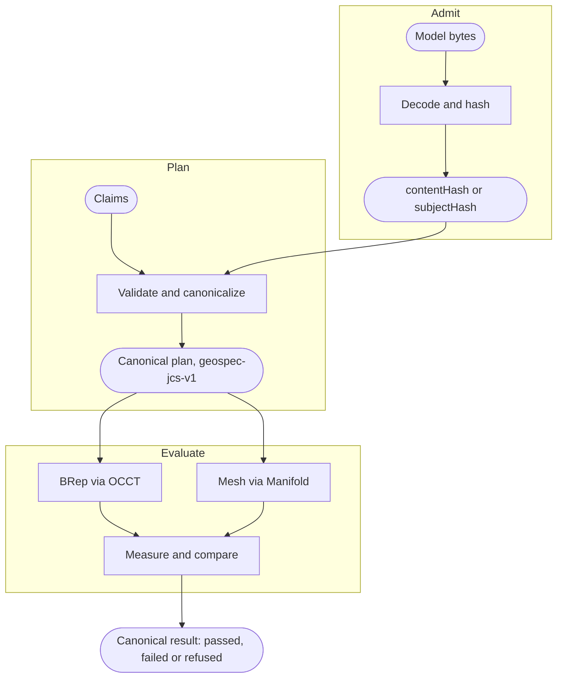
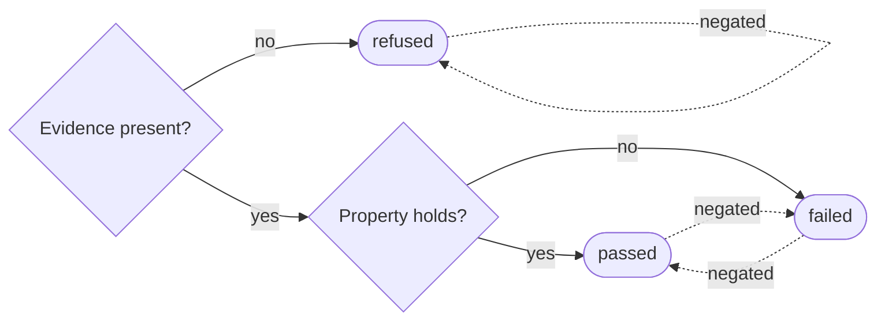

GeoSpec is a Rust core behind a byte-level protocol. Node, the browser and Python send the same JSON requests and get the same canonical JSON back; everything that decides a verdict happens in the core.

## Pipeline

A verdict moves through four stages. The first three can reject a request as a whole with a `ProtocolError`; the last answers each claim on its own with a status and diagnostics.

**Admit** reads a subject's bytes once and names it. A `mesh-buffer-v1` mesh is named by its `contentHash`, the SHA-256 of the bytes, which the request states and the engine checks. A STEP or glTF subject is named by a `subjectHash` derived from the bytes, frame and ingest options. Bytes this stage cannot read fail with `invalid-json`, `invalid-utf8`, `duplicate-key`, `invalid-number` or `limit-exceeded`; a header outside protocol 3, registry 5 and `geospec-jcs-v1` fails with `unsupported-version`; a frame the format does not admit, or a hash that does not match the bytes, fails with `invalid-request`.

**Plan** validates every claim and writes the canonical plan: subjects, claims, polarity, budgets and the `numericProfile`, as `geospec-jcs-v1` canonical JSON. A capability outside the registry is `unknown-capability`; an unknown payload field, a budget that is not a positive integer, or a slot no admitted subject fills is `invalid-claim`; more than 4,096 claims is `limit-exceeded`. The plan is what gets evaluated, so two requests with the same canonical plan ask the same question.

**Evaluate** measures each claim against the evidence its subject carries. A STEP solid is measured as BRep through OCCT; a mesh, from `mesh-buffer-v1` or glTF, through the Manifold backend. A claim whose evidence the subject lacks is refused with `GEOSPEC_EVIDENCE_UNSUPPORTED`; a y-up STEP subject refuses everything but `minimumDistance` with `GEOSPEC_UNSUPPORTED_EVIDENCE`; a claim that spends its `workUnitBudget` is refused with `MATCHER_TIMEOUT`; a backend that cannot complete refuses with `GEOSPEC_BACKEND_FAILED` or `GEOSPEC_INVALID_EVIDENCE`. A backend failure during admission is a `ProtocolError` with code `backend-failure`.

**Report** writes one result per claim in plan order, in the same canonical JSON, with the `numericProfile` that produced it. The host re-serializes nothing: `processRequest` returns the engine's bytes as they are.

## Subjects and evidence

A subject is one model the engine has admitted, bound to a slot in a plan.

- **`mesh-buffer-v1`** is ASCII `GSM1`, little-endian u32 vertex and triangle counts, f64 coordinates and u32 triangle indices. Its frame is fixed: z-up, millimetres. It goes through `ingestMesh` and is referenced by `contentHash`.
- **STEP** goes through `ingestSubject` with `coordinateSystem` `z-up` or `y-up`, `sourceUnit: 'auto'` and `outputUnit: 'mm'`: the file's own unit is read and the subject is measured in millimetres. `ingestOptions.name` names the product. STEP takes no external resources.
- **glTF and GLB** declare `coordinateSystem`, `sourceUnit` and `outputUnit`; a millimetre export must say `sourceUnit: 'mm'`. External buffers arrive as ordered, named `resources`. Separate meshes and instancing nodes stay separate operands.

The admission response returns the subject's name and, for files, a `descriptor` with the applied frame, the uniform scale and the SHA-256 of the primary bytes. The hash names bytes. It does not establish that the geometry is right, and the engine never infers a unit or an up axis the request did not declare.

Evidence follows the subject. A measurement names its `source`, `brep` for a STEP solid or `mesh` for triangles, and the evidence profile it was written under (`geospec-original24-v1`, or `mesh-bounds-v1` for mesh bounds). Feature claims such as holes, chamfers, fillets and wall thickness, BRep validity, topology counts, STEP units and product structure read BRep faces, so a mesh subject refuses them, and so does a STEP file whose faces carry no surface.

## The verdict

**Passed** and **failed** are answers about the geometry. A positive claim passes when the measured value satisfies the expectation; a negated claim (`polarity: 'negative'`) passes when it does not, and fails with `GEOSPEC_NEGATED_MATCH` when the property holds. **Refused** is not an answer: the engine could not decide the claim on the evidence it had, and negation leaves it refused. Every refusal and failure carries a diagnostic with a `code`, `severity`, `message` and usually a `suggestion` and `details`. [Read a refusal](/docs/guides/read-a-refusal) covers what to change.

## What a result promises

GeoSpec results are reproducible: the same model bytes, claims and engine build produce the same result bytes, so a result can be stored, hashed and compared later. [Reproduce a result](/docs/guides/reproduce-a-result) shows how.

What is reproducible:

- The canonical plan for a request, byte for byte, within one `canonicalProfile` (`geospec-jcs-v1`).
- The result bytes for a canonical plan, within one engine build and its `numericProfile` (`geospec-demand-v6`).
- A refusal: the same evidence gap refuses the same claim every time.
- Measured values, witnesses and the normalized expectation, including the tolerance the engine applied.

What is not:

- Byte equality across `numericProfile` values or engine versions. A measurement fix changes bytes, so treat a version bump as a baseline reset.
- Byte equality between the BRep and mesh backends: a STEP solid and its tessellation are different evidence, measured differently.
- A mathematically exact scalar. Measurements are binary64 values; equality is `abs(measured - expected) <= tolerance`, with a default tolerance of 0.02 mm and nominal equality at zero. Ordered comparisons such as `greaterThan` apply no tolerance.
- Work beyond the budget. Each claim declares a `workUnitBudget`; the engine's default is 8,000,000 work units, and a claim that exhausts it is refused with `MATCHER_TIMEOUT` rather than left running.

## Limits

- **No unit inference.** A mesh is millimetres because the protocol says so. A glTF file is whatever `sourceUnit` declares. A STEP file is read in its own unit only because `sourceUnit: 'auto'` asks for that.
- **No rendering.** The engine measures geometry and returns bytes. Pictures, display tessellation and file export belong to the host.
- **Refusal over guessing.** A claim without the evidence it needs is refused, never approximated. A hole claim on a mesh is refused even when the triangles plainly show a hole.
- **Holes are measured, not classified.** Hole matchers report diameter, axis and axis range. They do not establish through or blind as a topology proof.
- **Experimental qualification.** The `initialize` response reports the engine's `qualification` as `experimental` and most capabilities as `implementation: 'partial'`, `qualification: 'unqualified'`. Those fields describe the release; whether a subject admits a claim is decided by the claim's result.
